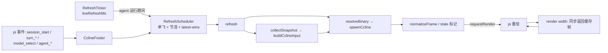

# Repository Guidelines

本文件面向在本仓库改代码的 AI 助手。`README.md` 是用户契约（行为、配置、限制），`HANDOFF.md` 是历史任务书与修复记录；两者与代码冲突时，以实际代码 + 用户确认为准，并顺手修文档。

## Project Overview

`pi-ccline` 是一个 [pi](https://pi.dev) 扩展：不做渲染，只从 pi 会话采集状态，拼成 Claude Code `statusLine` 形状的 JSON，spawn 外部 `CCometixLine`（`ccline`）二进制，把它的 ANSI stdout 当作 footer 显示。主题、配色、折行、图标全部归上游；本包的价值就是复用上游渲染。

- 零构建、零运行时依赖、只有 `peerDependencies`；已发布 npm `@caph42/pi-ccline`（`pi-ccline` 名字被他人占用），源码在 `github.com/Caph-dev/pi-ccline`。
- 不是 CLI、不是库、不是 provider：唯一入口是 `package.json` → `"pi": { "extensions": ["./extensions/pi-ccline/index.ts"] }`。
- 运行前提：Node（type stripping）+ `ccline` 2.0.1（已测版本）+ Nerd Font v3+ + TUI 模式。

## Architecture & Data Flow

- **组合根**：`index.ts` 默认导出 `piCcline(pi, deps)`。工厂里只注册事件/命令，不做 I/O、不起定时器——有些调用会加载扩展但不建会话。
- **每会话控制器**：`class CclineFooter`（`index.ts`）持有 `RefreshScheduler`、`RefreshTicker`、缓存帧、`AbortController`、`generation` 计数、宽度、theme、footerData。
- **两级调度**：事件 → `requestRefresh()` → `RefreshScheduler.request()`（始终 `setTimeout` 延后，最多一个在飞，pending 合并）→ `refresh()`。`RefreshTicker` 在 `agent_start`..`agent_end` 期间按 `liveRefreshMs` 敲同一个 scheduler，让「耗时」逐秒走；空闲不 spawn。
- **竞态处理**：每次刷新 `++generation`；结果回来若 `generation` 或 `disposed` 变了就丢弃；新刷新开始时 abort 上一个子进程。
- **失败即降级**：超时/非 0 退出 → 保留上一帧 + 行尾 dim ` ·stale`；找不到二进制 → 一行安装提示。绝不 throw 到 pi。
- **外部契约**：stdin JSON（省略 `version`，绝不编造 `rate_limits`；`COLUMNS` 控制折行）+ stdout ANSI。

### 不可违反的不变量

1. `render(width)` 是同步热路径，**绝不在里面 spawn**；只记录宽度变化并投递刷新请求。
2. 所有 ANSI 宽度判断用 `visibleWidth` / `truncateToWidth`（`@earendil-works/pi-tui`），**不用 `.length`**。
3. 不伪造数据：pi 没有的字段（`rate_limits`、`transcript_path`、累计 token）整段省略，让上游自己隐藏该段。
4. 配置坏/缺失/类型错 → 静默回退默认值或 clamp，不报错；写配置失败返回 `false`。
5. 只写自己的 `~/.pi/agent/pi-ccline/config.json`，不碰 pi 的 `settings.json`。
6. 不加运行时依赖：只用 `node:child_process` / `node:fs` / `node:os` / `node:path`（及 `node:url`）+ pi peer 包。

## Key Directories

| 路径 | 用途 |
|---|---|
| `extensions/pi-ccline/` | 全部源码，6 个运行模块 + 6 个同名 `.test.ts`（无 `src/`） |
| `scripts/render-once.ts` | 人工验收：fixture → 真实 ccline → 打印 ANSI 与可见宽度 |
| `fixtures/basic.json` | ccline 输入样例，只给 `render-once` 用，测试不读它 |
| `README.md` / `HANDOFF.md` | 用户契约 / 历史任务书 + 修复记录（中文） |

本包位于 `~/Workspace/pi-packages/pi-ccline`，与 `pi-advisor`、`pi-cursor-provider` 等平级；每个目录是独立项目，各有不同 toolchain（Bun / tsc / 各自 CI），**不要**把它们的约定搬过来。

## Development Commands

cwd = 本包根目录。以下均已验证。

| 命令 | 作用 | 何时用 |
|---|---|---|
| `npm test`（= `node --test`） | 全部 74 个测试，约 22s（footer 集成测试用真实定时器） | 任何改动后的唯一硬门禁 |
| `node --test extensions/pi-ccline/render.test.ts` | 单文件 | 定点调试 |
| `node --test --test-name-pattern="visible width" extensions/pi-ccline/render.test.ts` | 按标题过滤 | 单个行为 |
| `npm run render-once` | 默认 fixture，宽度 120 + 40 各跑一次真实 ccline | 改了 `input.ts` / `render.ts` / `binary.ts` 后必跑 |
| `node --experimental-strip-types scripts/render-once.ts --width 40 --binary ~/.claude/ccline/ccline --raw` | 单宽度 + 钉死二进制 + 原始 ANSI | 窄宽度/截断排查 |
| `node --experimental-strip-types scripts/render-once.ts --home "$(mktemp -d)" --binary ~/.claude/ccline/ccline` | 隔离 config 查找与子进程 `HOME` | 不想污染 `~/.claude/ccline/state/` |
| `node --experimental-strip-types -e "import('$PWD/extensions/pi-ccline/index.ts').then(m=>console.log(typeof m.default))"` | 验证入口可加载且默认导出 `function` | 改入口/import 形状后 |
| `pi -e "$PWD"` | 单次加载，不写 `settings.json`；TUI 里 `/pi-ccline status` | 交互冒烟 |
| `npm i -g @cometix/ccline` | 安装外部渲染器（先决条件） | 环境准备 |
| `npm pack --dry-run` | 检查将发布哪些文件（受 `files` 控制） | 发版前 |

**不存在** `build` / `lint` / `format` / `typecheck` / `watch` / `clean` 脚本，也没有 `tsconfig.json`、ESLint、Prettier、lockfile、CI。不要假设它们存在或顺手加。

`pi install npm:@caph42/pi-ccline`（或本地 `pi install .`）会写 `~/.pi/agent/settings.json`，只在用户明确要求时用；验证一律用 `pi -e`。

## Code Conventions & Common Patterns

**模块与语法（Node type stripping 约束）**
- ESM（`"type": "module"`）；相对导入必须带扩展名：`from "./config.ts"`；只用于类型的导入必须 `import type`。
- 只能用可擦除语法：禁止 `enum`、`namespace`、装饰器、构造函数参数属性。无 barrel 文件、无路径别名。
- 格式：tab 缩进、双引号、分号、尾逗号。没有 formatter 强制，照现有文件写。

**命名**
- 源码文件全小写单词：`index.ts` / `input.ts` / `binary.ts` / `render.ts` / `refresh.ts` / `config.ts`；测试为 `<module>.test.ts`，与源文件同目录。
- 类与接口 PascalCase、无 `I` 前缀（`CclineFooter`、`PiCclineConfig`）；函数/方法 camelCase；常量 `SCREAMING_SNAKE`（`MIN_THROTTLE_MS`）。
- 只依赖宿主能力的结构子集用 `*Like` 后缀，避免 import pi 内部类型：`type TuiLike = { requestRender(force?: boolean): void }`。

**错误处理（核心风格）**
- 模块边界不 throw。错误变成数据或默认值：`SpawnResult`（`ok | timedOut | aborted | error`）、`saveConfig(): boolean`、`loadConfig()` 回退 `DEFAULT_CONFIG`。
- 读宿主可选能力用 `try { … } catch { return fallback }`；读 ctx 用 `attempt(() => …)` 模式（`input.ts`）。
- 失败是可展示的产品行为：stale 帧、notice 帧、`ctx.ui.notify`，不是日志。源码里没有 `console.*` 和 logger。

**异步与并发**
- 统一 `async/await`；唯一 `new Promise` 在 `binary.ts` 包裹 `child_process`。
- 取消用 `AbortController` + `signal`；过期结果用单调 `generation` 丢弃。
- 定时器/时钟通过 options 注入，便于测试：`RefreshScheduler` 的 `now/setTimer/clearTimer`、`RefreshTicker` 的 `setInterval/clearInterval`。

**状态**
- 普通可变私有字段（`private frame`, `private pending`），无常驻 store/reducer/EventEmitter；对外只暴露 `readonly stats`。
- 会话状态每次刷新从 pi 重新计算，不落盘；只有配置持久化。

**配置**
- 路径固定 `join(homedir(), ".pi", "agent", "pi-ccline", "config.json")`；读取同步且宽容，写入 temp + `renameSync` 原子替换；数值 clamp（`timeoutMs` 200–60000，`refreshThrottleMs` ≥1000，`liveRefreshMs` 0 或 ≥250，上限均 60000）。

**渲染与文案**
- 用户可见文案英文、紧凑、`·` 分隔（`ccline not found · npm i -g @cometix/ccline · …`）；代码注释英文且解释「为什么」；README / HANDOFF 中文。
- 其他扩展的 `ctx.ui.setStatus` 必须继续可见：`render()` 实时读 `footerData.getExtensionStatuses()`，按 key 排序拼一行，超宽用 dim `…` 截断。

**已知偏差（改到相关代码时留意）**
- `binary.ts` 先写 `env.COLUMNS` 再 `Object.assign(env, options.env)`，所以配置 `env.COLUMNS` 会覆盖真实宽度——与 `README.md` 的「`COLUMNS` 除外」矛盾。
- `/pi-ccline` 命令处理器直接调模块级 `loadConfig()` / `resolveBinary()`，绕过了 `PiCclineDeps.loadConfig` 测试缝。
- `PI_CODING_AGENT_DIR` 未被尊重（硬编码 `homedir()`），与 pi 其它部分不一致。
- `config.ts` 的 `normalizeConfig` 内有一处顶格缩进的函数声明，属编辑残留；动该函数时先对齐格式。

## Important Files

| 文件 | 为什么重要 |
|---|---|
| `extensions/pi-ccline/index.ts` | 入口工厂、`CclineFooter`、全部事件接线、`/pi-ccline on\|off\|status\|path`；多数不变量落在这里 |
| `extensions/pi-ccline/input.ts` | pi → ccline 字段映射（纯函数）；「不伪造数据」的省略规则、provider 后缀、成本/上下文汇总 |
| `extensions/pi-ccline/refresh.ts` | 并发核心：单飞 + 节流 + latest-wins + ticker；改错会进程风暴或竞态 |
| `extensions/pi-ccline/binary.ts` | 解析顺序 `config.binary` → `~/.claude/ccline/ccline` → `PATH`；spawn 契约、超时、abort、`probeVersion` |
| `extensions/pi-ccline/render.ts` | ANSI 安全切分/截断、notice、stale 标记、扩展状态行；所有视觉正确性规则 |
| `extensions/pi-ccline/config.ts` | 默认值、clamp、原子读写；决定全部可调行为与容错 |
| `package.json` | 唯一入口契约（`pi.extensions`）、ESM、scripts、peerDeps；无其它 manifest 面 |
| `scripts/render-once.ts` | 唯一接触真实二进制的验收路径，含宽度契约断言 |
| `HANDOFF.md` | 设计意图、硬性约束、历史修复（含为何去掉累计 token 等决策） |
| `README.md` | 用户可见行为、配置语义、已知限制、上游版本基线（2.0.1） |

## Runtime/Tooling Preferences

- **Node，不是 Bun/Deno**：验证于 `v24.15.0`。`node --test` 直接跑 `.ts` 依赖 Node ≥22.18/24 的 type stripping；`engines.node = ">=22.19.0"`（跟随 pi-tui），Node 22 需显式 `--experimental-strip-types`。代码里无 `Bun.*`、`Deno.*`、`import.meta.dir`。
- **包管理器 npm**；无 lockfile、无 `node_modules`、无 `devDependencies`。peer 包（`@earendil-works/pi-tui` 等）靠目录向上查找（本机解析到 `/Users/caph/node_modules/`），新机器上先装 pi 才能跑测试。
- **pi 宿主条款**：`pi-ai` / `pi-agent-core` / `pi-coding-agent` / `pi-tui` / `typebox` 必须留在 `peerDependencies: "*"`，不能进 `dependencies`。pi 用 jiti 直接加载 `.ts`，因此**不需要也不要加**构建步骤。
- **外部二进制 `ccline` 2.0.1** 是硬前提：1.1.x 会把 `model`/`workspace`/`transcript_path` 当必填而失败。上游升级大版本后必须用 `render-once` 复验。
- **git 仓库**：`main` 分支，远端 `Caph-dev/pi-ccline`。发布流程为手动：`npm version <patch|minor|major>` → `git push --follow-tags` → `npm publish`（`publishConfig.access = public`）。没有 CI、changeset，测试需在发版前本地跑绿。
- npm tarball 内容由 `package.json` 的 `files` 控制：`extensions/`、`scripts/`、`fixtures/`、`README.md`。`HANDOFF.md` 与 `AGENTS.md` 只留在仓库里，不进包。

## Testing & QA

- 框架：`node:test` + `node:assert/strict`，标准库，无测试依赖、无 mock 库、无 snapshot。
- 布局：与源文件同目录的 `<module>.test.ts`，Node 默认 `**/*.test.ts` 发现。测试标题是完整行为句（`test("truncates by visible width, not string length", …)`），不用 `describe` 嵌套。
- 假件模式（照抄现有写法，不要引第三方 mock）：
  - 子进程边界：`mkdtempSync` 里写 `chmod 0755` 的 `/bin/sh` 脚本，`cat > /dev/null; printf 'ANSI…'`。
  - 时钟：注入 `FakeClock` / `FakeIntervalClock`。
  - 宿主对象：普通对象 + `as unknown as ExtensionContext`（`footer.test.ts` 的 `fakeContext` / `fakePi` / `footerData`）。
- 覆盖：无 coverage 配置、无阈值（`node --test --experimental-test-coverage` 可用但不接入）。当前 74 项全绿。
- 三层验证，按改动面选择：
  1. 单元：`npm test`（每次都跑；集成测试有真实定时器，机器繁忙时可能抖动）。
  2. 真实二进制：改了输入映射/渲染/二进制解析 → `npm run render-once`，宽度 120 与 40 都要看，确认不越界、不缺段。
  3. 交互：`pi -e "$PWD"` → `/pi-ccline status`，确认 footer 装上且无加载错误。
- 已知覆盖缺口：`/pi-ccline` 各子命令、非 TUI 早退分支（`ctx.mode !== "tui"`）、Windows 路径分支、二进制缓存命中路径均无测试。为新行为补测试时优先补这些。
- 新增测试只针对真实行为（映射、边界、竞态、降级），不要写「不抛错」「非空」这类空断言，也不要把实现细节钉死。
